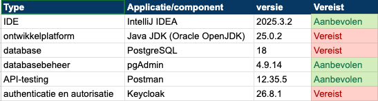

# Installatiehandleiding

## Inhoud
<!-- TOC -->
* [Installatiehandleiding](#installatiehandleiding)
  * [Inhoud](#inhoud)
  * [Inleiding](#inleiding)
    * [Het probleem dat deze API oplost](#het-probleem-dat-deze-api-oplost)
    * [Kernfunctionaliteiten](#kernfunctionaliteiten)
  * [Lijst van benodigdheden](#lijst-van-benodigdheden)
  * [Overzicht van projectstructuur](#overzicht-van-projectstructuur)
  * [Het project lokaal opzetten](#het-project-lokaal-opzetten)
  * [Testen](#testen)
    * [Endpoints testen met Postman](#endpoints-testen-met-postman)
    * [Unit tests](#unit-tests)
    * [Integratietests](#integratietests)
<!-- TOC -->

## Inleiding

### Het probleem dat deze API oplost
Deze API vormt een centraal informatiepunt voor medewerkers van een geluidsverhuurbedrijf. Hier kunnen ze alle actuele informatie vinden die ze nodig hebben om de geluidsversterking te verzorgen bij een event.

### Kernfunctionaliteiten
1. Als manager wil ik personen kunnen voorzien van een employeeProfile en/of performerProfile, zodat ik aanvullende informatie kan vastleggen die specifiek is voor hun rol binnen de organisatie of een optreden.
2. Als manager wil ik personen en acts aan een event kunnen koppelen, zodat duidelijk is welke medewerkers en performers betrokken zijn bij het event en welke acts er optreden.
3. Als engineer wil ik apparatuur met bijbehorende specificaties en afbeeldingen kunnen toevoegen aan, aanpassen in en verwijderen uit de equipmentcollectie van het audiobedrijf, zodat ik een actueel overzicht heb van de beschikbare apparatuur.
4. Als engineer wil ik de benodigde apparatuur aan een event kunnen koppelen en de instrumenten en geluidsbronnen van performers aan mixerkanalen kunnen toewijzen, zodat ik een compleet technisch overzicht heb van de benodigde apparatuur en de kanaalindeling voor een optreden.


## Lijst van benodigdheden




## Overzicht van projectstructuur
Voor de projectstructuur heb ik gebruikgemaakt van Springboot. Dependencies worden gemanaged door Maven.

``` text
.

├── HELP.md
├── mvnw
├── mvnw.cmd
├── pom.xml
├── project-structure.txt
└── src
├── main
│   ├── java
│   │   └── nl
│   │       └── novi
│   │           └── eindopdracht
│   │               ├── EindopdrachtApplication.java
│   │               ├── config
│   │               │   ├── ImageDataInitializer.java
│   │               │   ├── JwtAudienceValidator.java
│   │               │   └── SecurityConfig.java
│   │               ├── controllers
│   │               │   ├── ActController.java
│   │               │   ├── ChannelController.java
│   │               │   ├── EmployeeProfileController.java
│   │               │   ├── EquipmentController.java
│   │               │   ├── EquipmentEventAssignmentController.java
│   │               │   ├── EventAssignmentController.java
│   │               │   ├── EventController.java
│   │               │   ├── ImageController.java
│   │               │   ├── InstrumentController.java
│   │               │   ├── MicrophoneController.java
│   │               │   ├── MixerController.java
│   │               │   ├── PerformanceController.java
│   │               │   ├── PerformerActController.java
│   │               │   ├── PerformerInstrumentController.java
│   │               │   ├── PerformerProfileController.java
│   │               │   ├── PersonController.java
│   │               │   └── SourceController.java
│   │               ├── dtos
│   │               │   ├── act
│   │               │   │   ├── ActRequestDto.java
│   │               │   │   └── ActResponseDto.java
│   │               │   ├── channel
│   │               │   │   ├── ChannelRequestDto.java
│   │               │   │   └── ChannelResponseDto.java
│   │               │   ├── employeeProfile
│   │               │   │   ├── EmployeeProfileRequestDto.java
│   │               │   │   └── EmployeeProfileResponseDto.java
│   │               │   ├── equipment
│   │               │   │   ├── EquipmentRequestDto.java
│   │               │   │   └── EquipmentResponseDto.java
│   │               │   ├── equipmentEventAssignment
│   │               │   │   ├── EquipmentEventAssignmentRequestDto.java
│   │               │   │   └── EquipmentEventAssignmentResponseDto.java
│   │               │   ├── event
│   │               │   │   ├── EventRequestDto.java
│   │               │   │   └── EventResponseDto.java
│   │               │   ├── eventAssignment
│   │               │   │   ├── EventAssignmentRequestDto.java
│   │               │   │   └── EventAssignmentResponseDto.java
│   │               │   ├── image
│   │               │   │   ├── ImageRequestDto.java
│   │               │   │   └── ImageResponseDto.java
│   │               │   ├── instrument
│   │               │   │   ├── InstrumentRequestDto.java
│   │               │   │   └── InstrumentResponseDto.java
│   │               │   ├── microphone
│   │               │   │   ├── MicrophoneRequestDto.java
│   │               │   │   └── MicrophoneResponseDto.java
│   │               │   ├── mixer
│   │               │   │   ├── MixerRequestDto.java
│   │               │   │   └── MixerResponseDto.java
│   │               │   ├── performance
│   │               │   │   ├── PerformanceRequestDto.java
│   │               │   │   └── PerformanceResponseDto.java
│   │               │   ├── performerAct
│   │               │   │   ├── PerformerActRequestDto.java
│   │               │   │   └── PerformerActResponseDto.java
│   │               │   ├── performerInstrument
│   │               │   │   ├── PerformerInstrumentRequestDto.java
│   │               │   │   └── PerformerInstrumentResponseDto.java
│   │               │   ├── performerProfile
│   │               │   │   ├── PerformerProfileRequestDto.java
│   │               │   │   └── PerformerProfileResponseDto.java
│   │               │   ├── person
│   │               │   │   ├── PersonRequestDto.java
│   │               │   │   └── PersonResponseDto.java
│   │               │   └── source
│   │               │       ├── SourceRequestDto.java
│   │               │       └── SourceResponseDto.java
│   │               ├── entities
│   │               │   ├── ActEntity.java
│   │               │   ├── BaseEntity.java
│   │               │   ├── ChannelEntity.java
│   │               │   ├── EmployeeProfileEntity.java
│   │               │   ├── EquipmentEntity.java
│   │               │   ├── EquipmentEventAssignmentEntity.java
│   │               │   ├── EventAssignmentEntity.java
│   │               │   ├── EventEntity.java
│   │               │   ├── ImageEntity.java
│   │               │   ├── InstrumentEntity.java
│   │               │   ├── MicrophoneEntity.java
│   │               │   ├── MixerEntity.java
│   │               │   ├── PerformanceEntity.java
│   │               │   ├── PerformerActEntity.java
│   │               │   ├── PerformerInstrumentEntity.java
│   │               │   ├── PerformerProfileEntity.java
│   │               │   ├── PersonEntity.java
│   │               │   └── SourceEntity.java
│   │               ├── enums
│   │               │   ├── DriversLicense.java
│   │               │   ├── EventRole.java
│   │               │   └── PolarPattern.java
│   │               ├── exceptions
│   │               │   ├── DuplicateRecordException.java
│   │               │   ├── GlobalExceptionHandler.java
│   │               │   ├── RecordInUseException.java
│   │               │   └── RecordNotFoundException.java
│   │               ├── helpers
│   │               │   └── UrlHelper.java
│   │               ├── mappers
│   │               │   ├── ActDtoMapper.java
│   │               │   ├── ChannelDtoMapper.java
│   │               │   ├── DtoMapper.java
│   │               │   ├── EmployeeProfileDtoMapper.java
│   │               │   ├── EquipmentEventAssignmentDtoMapper.java
│   │               │   ├── EventAssignmentDtoMapper.java
│   │               │   ├── EventDtoMapper.java
│   │               │   ├── ImageDtoMapper.java
│   │               │   ├── InstrumentDtoMapper.java
│   │               │   ├── MicrophoneDtoMapper.java
│   │               │   ├── MixerDtoMapper.java
│   │               │   ├── PerformanceDtoMapper.java
│   │               │   ├── PerformerActDtoMapper.java
│   │               │   ├── PerformerInstrumentDtoMapper.java
│   │               │   ├── PerformerProfileDtoMapper.java
│   │               │   ├── PersonDtoMapper.java
│   │               │   └── SourceDtoMapper.java
│   │               ├── repositories
│   │               │   ├── ActRepository.java
│   │               │   ├── ChannelRepository.java
│   │               │   ├── EmployeeProfileRepository.java
│   │               │   ├── EquipmentEventAssignmentRepository.java
│   │               │   ├── EquipmentRepository.java
│   │               │   ├── EventAssignmentRepository.java
│   │               │   ├── EventRepository.java
│   │               │   ├── ImageRepository.java
│   │               │   ├── InstrumentRepository.java
│   │               │   ├── MicrophoneRepository.java
│   │               │   ├── MixerRepository.java
│   │               │   ├── PerformanceRepository.java
│   │               │   ├── PerformerActRepository.java
│   │               │   ├── PerformerInstrumentRepository.java
│   │               │   ├── PerformerProfileRepository.java
│   │               │   ├── PersonRepository.java
│   │               │   └── SourceRepository.java
│   │               └── services
│   │                   ├── ActService.java
│   │                   ├── ChannelService.java
│   │                   ├── EmployeeProfileService.java
│   │                   ├── EquipmentEventAssignmentService.java
│   │                   ├── EquipmentService.java
│   │                   ├── EventAssignmentService.java
│   │                   ├── EventService.java
│   │                   ├── ImageService.java
│   │                   ├── InstrumentService.java
│   │                   ├── MicrophoneService.java
│   │                   ├── MixerService.java
│   │                   ├── PerformanceService.java
│   │                   ├── PerformerActService.java
│   │                   ├── PerformerInstrumentService.java
│   │                   ├── PerformerProfileService.java
│   │                   ├── PersonService.java
│   │                   └── SourceService.java
│   └── resources
│       ├── application.properties
│       ├── data.sql
│       ├── static
│       │   └── images
│       │       └── shure_sm58.jpg
│       └── templates
└── test
├── java
│   └── nl
│       └── novi
│           └── eindopdracht
│               ├── DtoMapperTests
│               │   ├── ActDtoMapperTest.java
│               │   └── SourceDtoMapperTest.java
│               ├── EindopdrachtApplicationTests.java
│               ├── controllers
│               │   ├── EmployeeProfileControllerIntergrationTest.java
│               │   └── PerformerInstrumentControllerIntegrationTest.java
│               └── services
│                   ├── EmployeeProfileServiceTest.java
│                   └── PerformerInstrumentServiceTest.java
└── resources
├── application-test.properties
└── data-test.sql

47 directories, 149 files
```

## Het project lokaal opzetten

1. **Het project downloaden**
  - Clone de GitHub repository of open de ‘eindopdracht’ projectmap in je IDE.
  - [GitHub repository](https://github.com/stefanversterker/BE_Eindopdracht/tree/main)

2. **Java installeren**
  - Installeer Oracle OpenJDK 25.0.2.
    - Download: [Oracle OpenJDK 25.0.2](https://www.oracle.com/java/technologies/downloads/?utm_source=chatgpt.com#jdk25-mac)
    - Kies de installer die bij jouw besturingssysteem hoort.
    - Versie 25.0.2 is gebruikt bij het ontwikkelen van deze applicatie.
  - Controleer na de installatie in je terminal of Java correct is geïnstalleerd:
    - `java -version`
  - Kies een SDK:
    - Ga naar: **File > Project Structure > Project**
    - Kies bij het SDK-veld voor **Oracle OpenJDK 25.0.2**.

3. **PostgreSQL installeren**
  - Installeer PostgreSQL 18:
    - [PostgreSQL](https://www.postgresql.org/)

4. **pgAdmin installeren**
   - Download pgAdmin 4: [pgAdmin](https://www.pgadmin.org/)
   - Installeer pgAdmin 4

5. **Een connectie maken tussen pgAdmin en PostgreSQL**
  - Ga naar: **Servers > Register > Servers…**
  - Vul op het tabblad **General** een zelfgekozen naam in.
  - Vul op het tabblad **Connection** deze properties in:
    - Host name/address: `localhost`
    - Port: `5432`
    - Maintenance database: `postgres`
    - Username: `postgres`
    - Password: *(jouw PostgreSQL-wachtwoord)*

6. **Een nieuwe database aanmaken in PostgreSQL met behulp van pgAdmin**
  - Klik met je rechtermuisknop op **Databases** en kies **Create > Database…**
  - Vul de volgende properties in:
    - Database: `eindopdracht`
    - OID: leeglaten
    - Owner: `postgres`
    - Comment: *(leeg laten)*
  - Klik op **Save**.

7. **Het application.properties-bestand configureren**
  - Ga in de projectmap naar `src > main > resources > application.properties`.
  - Vul je eigen PostgreSQL-inloggegevens in:
    - `POSTGRESQL_USERNAME =` *(jouw PostgreSQL-gebruikersnaam)*
    - `POSTGRESQL_PASSWORD =` *(jouw PostgreSQL-wachtwoord)*
  - Controleer of de database-URL naar de juiste poort verwijst:
    - `spring.datasource.url=jdbc:postgresql://localhost:5432/${POSTGRESQL_DATABASENAME}`
    - Vervang `5432` indien PostgreSQL op jouw computer een andere poort gebruikt.

8. **Keycloak setup**
  - Download Keycloak: [Keycloak](https://www.keycloak.org/getting-started/getting-started-zip)
  - Importeer de `novi_eindopdracht`-realm met het volgende commando:
    - Mac/Linux: `./bin/kc.sh import --dir ~/pad/naar/keycloak-export`
    - Windows: `bin\kc.bat import --dir C:\pad\naar\keycloak-export`
  - Start Keycloak op poort 9090 met het volgende commando:
    - Mac/Linux: `./bin/kc.sh start-dev --http-port 9090`
    - Windows: `bin\kc.bat start-dev --http-port 9090`
  - Keycloak is nu bereikbaar via [http://localhost:9090](http://localhost:9090).
  - Maak een administratoraccount aan als je dat nog niet hebt.

9. **Het project bouwen**
  - Open de projectmap in je terminal en voer het volgende commando uit:
    - Mac/Linux: `./mvnw clean install`
    - Windows: `.\mvnw.cmd clean install`

10. **De Spring Boot-applicatie starten**
  - Mac/Linux: `./mvnw spring-boot:run`
  - Windows: `.\mvnw.cmd spring-boot:run`
  - Of klik op de **Play**-knop bovenaan je IntelliJ-scherm.

11. **Postman setup**
  - Download en installeer Postman als je dat nog niet gedaan hebt.
  - Maak een Postman-account aan.
  - Importeer de Postman-collection:
    - Klik in Postman op het **Use resources or import**-icoontje.
    - Kies het bestand `eindopdracht.postman_collection.json`.
  - Importeer de Postman-environment:
    - Klik in Postman op het **Use resources or import**-icoontje.
    - Kies het bestand `eindopdracht local.postman_environment.json`.
  - Selecteer de `eindopdracht local`-environment:
    - Klik op de Environment-dropdown rechtsboven in je Postman-scherm.
    - Selecteer **eindopdracht local**.
  - Haal een nieuwe access token op:
    - Selecteer de `eindopdracht`-collection.
    - Ga naar de tab **Authorization**.
    - Klik op de knop **Get New Access Token**.
    - Als het goed is, verschijnt er een Keycloak-inlogscherm. Log hier in met één van de testaccounts.

12. **De API testen**
  - Je kunt nu de verschillende API-endpoints testen.
  - Welke endpoints toegankelijk zijn, is afhankelijk van de rol van het account waarmee je bent ingelogd.

## Testen

### Endpoints testen met Postman

Met behulp van Postman kunnen alle endpoints van deze API getest worden.

In de API-documentatie vind je onder het hoofdstuk 'Endpoints met
omschrijving' een overzicht van alle beschikbare endpoints, inclusief
een korte beschrijving van hun functionaliteit. Onder het hoofdstuk
'Endpoints met requestvoorbeeld' vind je voor ieder endpoint een
voorbeeldrequest met de bijbehorende verwachte response.

### Unit tests

Voor het testen van de servicelaag heb ik de klassen
EmployeeProfileService en PerformerInstrumentService voorzien van unit
tests. Samen zorgen deze tests voor een line coverage van 100% binnen de
betreffende serviceklassen.

Je kunt dit controleren met de volgende stappen:
- Open EmployeeProfileServiceTest en PerformerInstrumentServiceTest.
- Klik op het groene afspeelicoon links naast de klassedeclaratie.
- Kies in het dropdownmenu voor 'Run \[testklasse\] with Coverage'.

In het Coverage-venster kun je vervolgens controleren of beide
serviceklassen een line coverage van 100% hebben.

### Integratietests

Voor het testen van de controllerlaag heb ik integratie tests opgezet
voor EmployeeProfileController en PerformerInstrumentController.

Je kunt deze tests uitvoeren met de volgende stappen:
- Open de betreffende integratietestklassen.
- Klik op het groene afspeelicoon links naast de klassedeclaratie.
- Kies in het dropdownmenu voor 'Run \[testklasse\]'.

Na het uitvoeren kun je in IntelliJ controleren of de tests succesvol
zijn afgerond.
